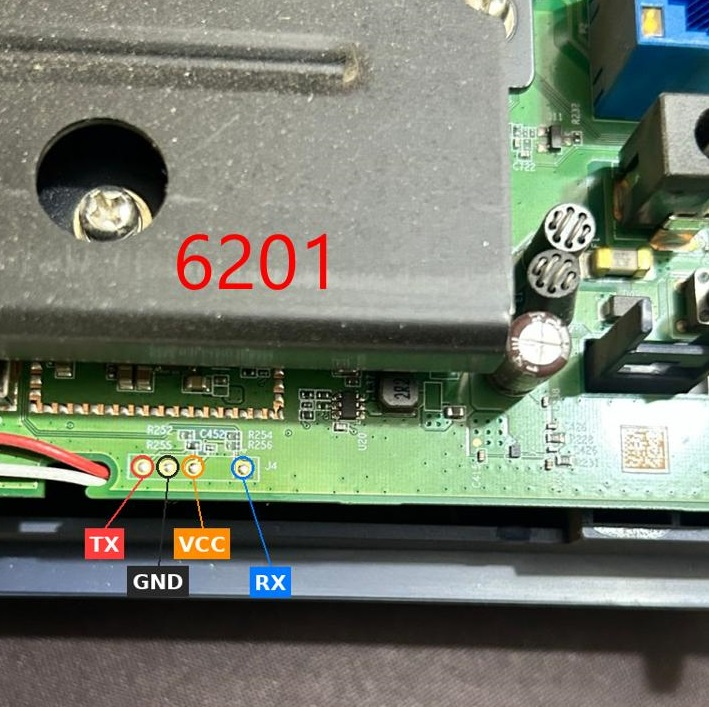
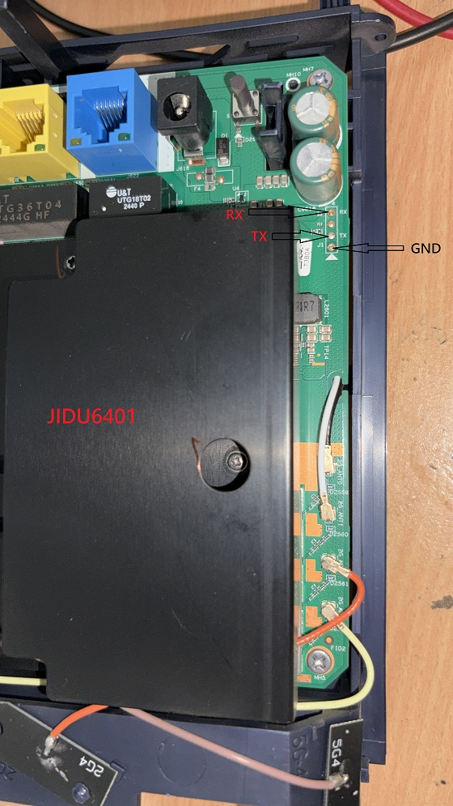
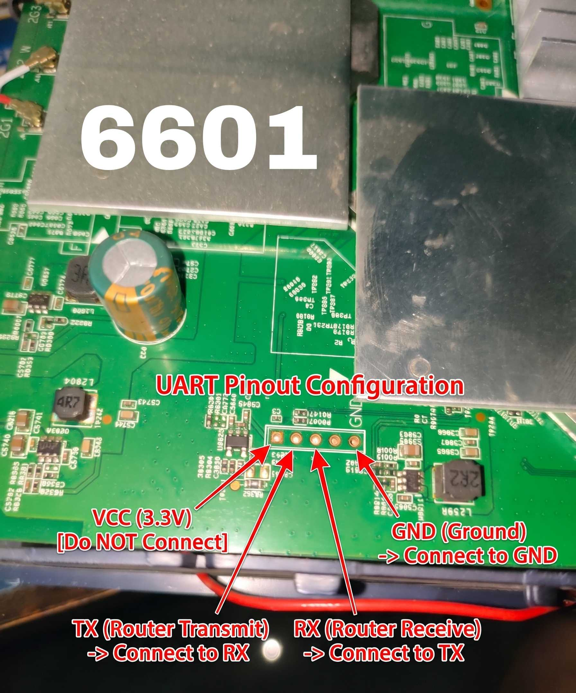
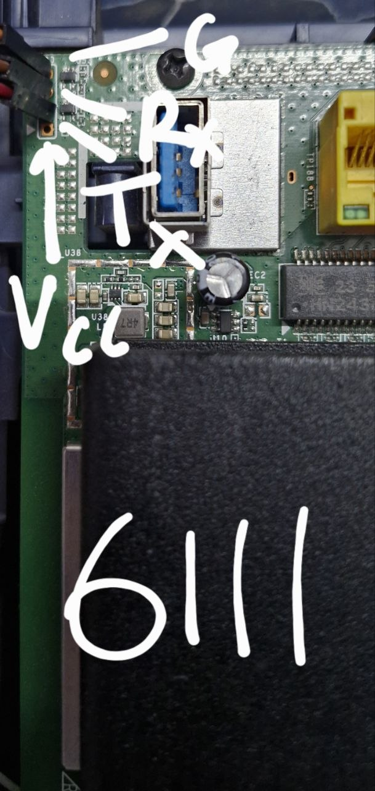
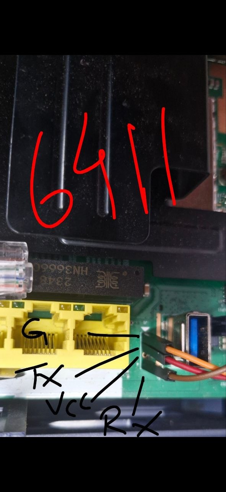
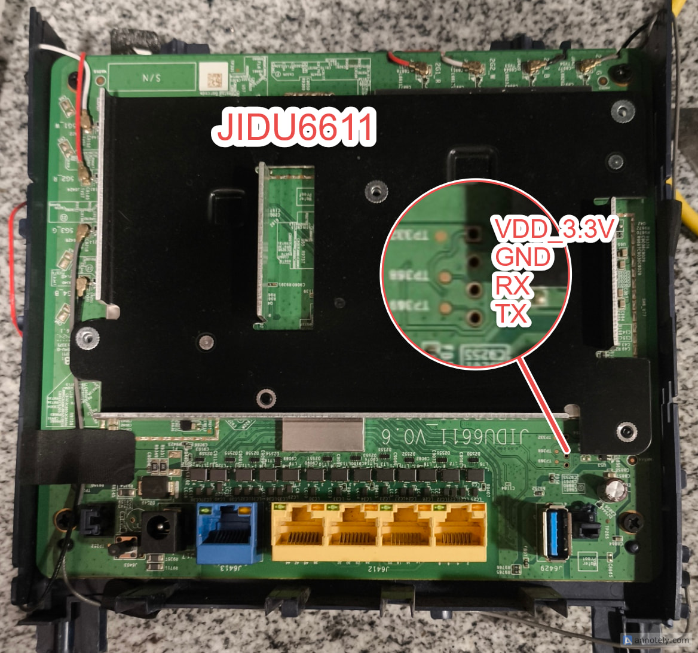
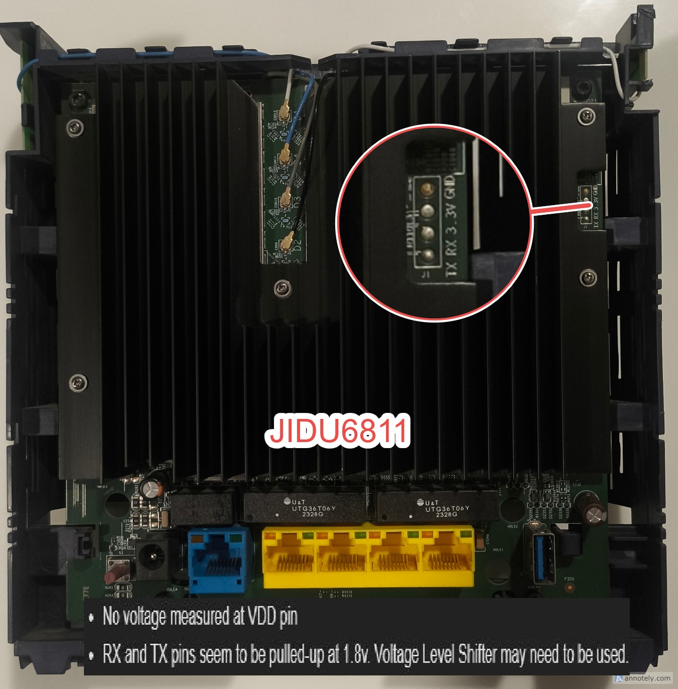
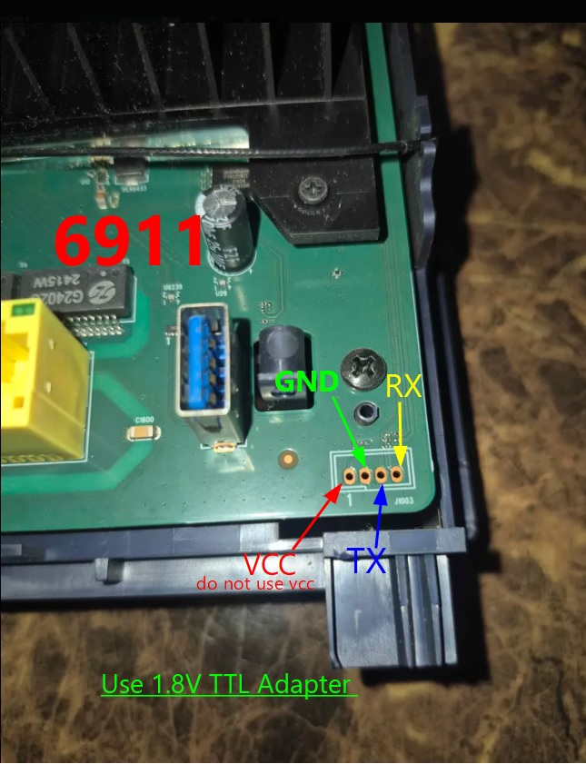

---
## Credits

The_DiY_Daddy discord community and Openwrt-Forum

---
## License

This project is licensed under a **Custom Personal-Use License** (Commercial use and video creation are strictly prohibited) — see the [LICENSE](LICENSE) file for details.
